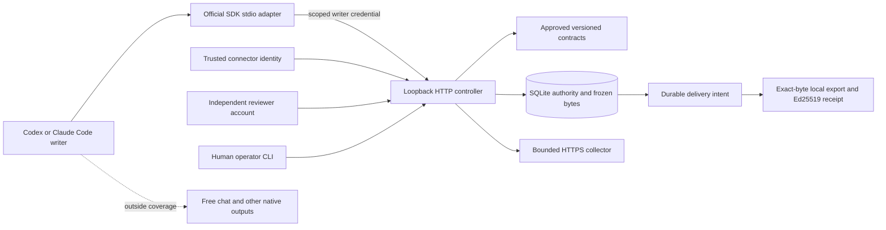
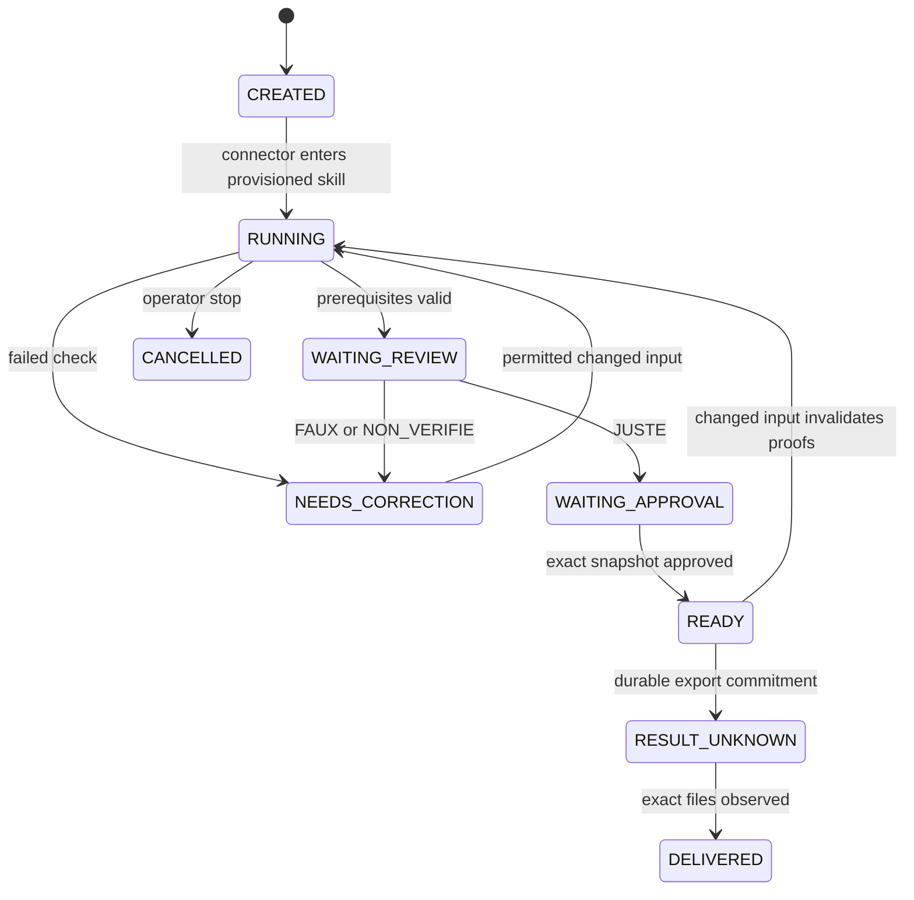

# Architecture and authority

The native integration adds `ClientBridge`, workspace-scoped user hooks and a
cwd-selecting stdio adapter. The operator's case policy admits all compulsory
invocations before model work; observed skill selection is informational. The
writer cannot create a case, choose its profile or impersonate a reviewer.
Client event bodies cannot set progress or prove an OS effect. Installed skill
hashes guard direct API mutation and automatic delivery. A changed approved
contract invalidates progress/review after registry reload. The delivery worker
never supplies mandatory human approval. See [native limits](client-compatibility.md).

SkillFlow is an alpha controller, independent of `/phases`. Python adapters use
the official MCP SDK; business decisions run only in `Controller.call`. SQLite
uses WAL, FULL synchronization, foreign keys, BEGIN IMMEDIATE and schema version 1.
A daemon lock rejects a second HTTP authority process. The demo is a same-user
fixture: its local files and credentials are deliberately inspectable.

Separate tables hold cases, invocations, steps, obligations, input pointers,
immutable artifacts, proofs, reviews, approvals, delivery intents, sessions,
idempotent operations, branch decisions, revocations and append-only events.
Each case key is bound to an operator-provisioned profile. Writers cannot start
cases, change profiles, resolve branches, invent child slots or supply evidence.

Artifacts are bounded base64 UTF-8 bytes copied into SQLite BLOBs. SHA-256 is
computed on the owned copy. No writer filesystem path reaches privileged import
code. Text and JSON are covered; DOCX, HTML and executable formats are refused.
Sources are exact contract URLs, HTTPS only, public DNS addresses only, resolved
once and pinned for the TLS connection. No redirects, proxies, compression,
HTML login pages or truncated bodies are accepted. Source provenance establishes
transfer and byte identity, not applicability or understanding.

Every mutating action needs a current revision and an idempotency key. Repeating
the same authenticated key and envelope returns its original response. Reusing
it with different arguments or a different revision is an error. This includes
refused operations. One serialized SQLite writer prevents concurrent budget use.
The collector durably reserves its budget/key before a bounded network read,
then accepts the result only if the reserved revision is still current. A process
kill retains that reservation as RESULT_UNKNOWN. A new read requires a new key
and remaining budget; no arbitrary command executes as the controller.

Contract dependency edges are acyclic. Correction loops are separate transitions.
Optional branches remain unresolved until an operator fixes a value. Required
children are instantiated at case creation; requesting their slot again reuses
the same invocation. Own work steps and child work steps are distinct units;
invocation group headings are never extra completed work.

READY is descriptive, not a bypass: delivery recomputes guards. Approval covers
the exact snapshot, original review, destination alias and case revision.
Any subsequent mutation makes its revision stale. Cancellation before commitment
prevents export; after commitment the effect must be reconciled. The outbox uses
generated directories and exclusive file creation; it never overwrites differing
bytes. Receipt sidecars and review sidecars do not alter the artifact itself.
External email, printing, cloud uploads and arbitrary shell execution are absent.

Future migrations must retain immutable object IDs, historical receipts and
budgets. Unknown database versions fail at startup. Distributed writers and
multi-machine delivery require a new storage/effect design; this alpha has one
daemon and bounded local objects.
